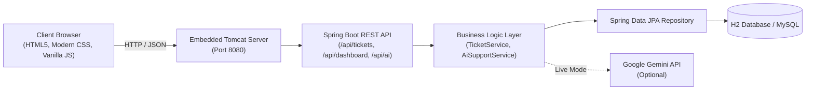

# 🎫 AI-Powered Customer Support Ticketing System

An enterprise-grade, modern customer support desk and ticket lifecycle management application built for the **SkillWallet Capstone Project** (2nd-Year BTech CSE). 

Featuring real-time SLA metrics, an interactive 5-stage **Kanban workflow**, dual-mode **AI ticket classification & response drafting** (powered by Google Gemini with resilient offline rule-based fallback), and full persistence via Spring Data JPA and H2/MySQL.

---

## 🌟 Key Features

1. **Ticket Lifecycle Management**
   - Submit tickets with Customer Name, Email, Subject, Description, Category, and Priority.
   - 5-Stage Status Workflow: `New` → `In Progress` → `Waiting for Customer` → `Resolved` → `Closed`.
   - 4 Priority Levels: `Low`, `Medium`, `High`, `Critical`.
   - Resolution timestamps and dedicated audit comments for tracking ticket history.

2. **Interactive Kanban Board**
   - Visual drag-and-drop workflow across all 5 ticket lifecycle columns.
   - Quick one-click advance status arrows (`→`).
   - Real-time column counters and immediate persistence.

3. **Hybrid Dual-Mode AI Engine**
   - **Mode 1: Google Gemini 1.5 Flash Live API** (when an API key is provided).
   - **Mode 2: High-Accuracy Rule-Based NLP Demo Engine** (offline fallback with 0 latency and 0 cost).
   - **AI Auto-Classification:** Automatically determines ticket category, recommends priority, and estimates confidence score.
   - **AI Response Drafting:** Drafts polite, contextual, empathetic support responses that agents can insert into replies with one click.

4. **Live Analytics Dashboard**
   - Real-time SLA summary cards: Total Tickets, Open/Active, Waiting for Customer, Resolved/Closed, and Critical Issues.
   - **Interactive Charts (Chart.js):**
     - Status Breakdown (Doughnut Chart)
     - SLA Priority Breakdown (Bar Chart)
     - Category Distribution (Horizontal Bar Chart)

5. **Ticket Filtering, Search & Sorting**
   - Instant debounced multi-keyword search (subject, description, customer name, email, ticket #).
   - Multi-criteria dropdown filters: Filter by Status, Priority, and Category.
   - Flexible sorting: Newest First, Oldest First, Priority (High to Low), Subject (A-Z).

6. **Agent Collaboration & Activity Thread**
   - Multi-comment conversation thread per ticket.
   - Support for customer replies, agent answers, and private **Internal Agent Notes** (with distinct visual badges).
   - Automated audit logs when ticket status or agent assignments change.

7. **Zero-Configuration Embedded Database**
   - Embedded **H2 Database** enabled by default — runs immediately with 0 database installation required!
   - Pre-configured H2 Web Console accessible at `http://localhost:8080/h2-console`.
   - Production-ready **MySQL profile** included (`application-mysql.properties`) for 1-step switching.

8. **Pre-Seeded Realistic Demo Data**
   - Automatically populates 8 diverse, realistic tickets across different statuses and categories on initial startup.

---

## 🏗️ Architecture & Technology Stack



| Component | Technology | Description |
|-----------|------------|-------------|
| **Backend** | Java 17+ / Spring Boot 3.3.5 | RESTful Web Services, Spring Data JPA, Hibernate, Bean Validation |
| **Frontend** | HTML5, CSS3, Vanilla ES6+ JavaScript | Responsive Single Page Dashboard, Flexbox/Grid, Accessible UI |
| **Data Visuals** | Chart.js 4.4+ (CDN) | Dynamic charts for Status, Priority, and Category metrics |
| **Database** | H2 (Default) / MySQL (Optional) | In-memory/embedded persistent storage with H2 Web Console |
| **AI Layer** | Google Gemini API + Rule-Based Engine | Dual-mode intelligent classifier & reply generator |
| **Build Tool** | Apache Maven & Maven Wrapper (`./mvnw`) | Standard reproducible Java build harness |

---

## 📋 Prerequisites

To run this application locally on your computer:
1. **Java Development Kit (JDK):** Version 17, 21, or 26.
   - Verify by typing: `java -version`
2. **Maven:** Bundled via included Maven Wrapper (`./mvnw`), or standard global Maven (`mvn`).
3. **Web Browser:** Google Chrome, Mozilla Firefox, Safari, or Microsoft Edge.

---

## 🚀 Step-by-Step Local Setup Guide

### 1. Clone or Open the Repository
```bash
git clone <your-github-repo-url>
cd ai-customer-support-ticketing
```

### 2. Configure Environment (Optional)
The project works out of the box in **High-Accuracy Rule-Based Demo Mode** with zero configuration required.

If you have a Google Gemini API key and want to enable live LLM responses:
```bash
# macOS / Linux:
export GEMINI_API_KEY="your_actual_gemini_api_key_here"

# Windows (Command Prompt):
set GEMINI_API_KEY=your_actual_gemini_api_key_here

# Windows (PowerShell):
$env:GEMINI_API_KEY="your_actual_gemini_api_key_here"
```

### 3. Run the Application
Run using the included Maven Wrapper:

```bash
# macOS / Linux:
./mvnw spring-boot:run

# Windows:
mvnw.cmd spring-boot:run
```

*Alternatively, if you have Maven installed globally:*
```bash
mvn spring-boot:run
```

### 4. Access the Application
Open your web browser and navigate to:
- **Main Web Application:** [`http://localhost:8080`](http://localhost:8080)
- **H2 Database Web Console:** [`http://localhost:8080/h2-console`](http://localhost:8080/h2-console)
  - *JDBC URL:* `jdbc:h2:mem:ticketdb`
  - *Username:* `sa`
  - *Password:* *(leave blank)*

---

## 🧪 Demo Personas & Test Credentials

The application includes pre-configured personas for demonstration and viva presentation:

| Persona | Role | Primary Usage |
|---------|------|---------------|
| **Alex Rivera** | Lead Support Specialist | Assign tickets, add internal notes, generate AI drafts, resolve tickets |
| **Sarah Chen** | Senior Customer Agent | Manage billing inquiries and tax VAT updates |
| **Customer User** | End Customer | Submit new tickets, test AI auto-classification, view ticket updates |

---

## 🔌 REST API Reference

| Method | Endpoint | Description |
|--------|----------|-------------|
| `GET` | `/api/tickets` | Retrieve all tickets with optional filtering (`status`, `priority`, `category`, `search`) and sorting |
| `GET` | `/api/tickets/{id}` | Retrieve specific ticket by ID, including comment history |
| `POST` | `/api/tickets` | Submit a new support ticket (triggers automatic AI metadata enrichment) |
| `PUT` | `/api/tickets/{id}` | Update ticket status, priority, assigned agent, or resolution notes |
| `DELETE` | `/api/tickets/{id}` | Delete a ticket by ID |
| `POST` | `/api/tickets/{id}/comments` | Post a comment or internal agent note to a ticket |
| `GET` | `/api/dashboard/stats` | Retrieve aggregated dashboard counts and chart metrics |
| `POST` | `/api/ai/analyze` | Request AI categorization, priority recommendation, and response draft |
| `GET` | `/api/ai/status` | Check whether AI is running in Gemini Live or Rule-Based Demo Mode |

---

## 🗄️ Switching to MySQL (Production Database)

If you wish to run the application with MySQL instead of H2:

1. Ensure MySQL server is running and create the database:
   ```sql
   CREATE DATABASE ticketdb;
   ```
2. Open `src/main/resources/application-mysql.properties` and verify your MySQL username and password.
3. Start the application with the `mysql` profile:
   ```bash
   ./mvnw spring-boot:run -Dspring-boot.run.profiles=mysql
   ```

---

## 📁 Repository Structure

```
ai-customer-support-ticketing/
├── pom.xml                                  # Maven dependencies and build plugins
├── mvnw / mvnw.cmd                          # Maven wrapper executables
├── src/
│   ├── main/
│   │   ├── java/com/skillwallet/ticketing/
│   │   │   ├── TicketingApplication.java    # Spring Boot entry point & demo seeder
│   │   │   ├── model/                       # JPA entities (Ticket, Comment) & Enums
│   │   │   ├── repository/                  # Spring Data JPA repositories
│   │   │   ├── service/                     # Business logic & AI dual-mode service
│   │   │   ├── controller/                  # REST API endpoints & exception handling
│   │   │   └── dto/                         # Request/Response Data Transfer Objects
│   │   └── resources/
│   │       ├── application.properties       # H2 database & app configuration
│   │       ├── application-mysql.properties # MySQL production profile
│   │       └── static/                      # Frontend single page application
│   │           ├── index.html               # Main dashboard UI
│   │           ├── css/styles.css           # Modern responsive design
│   │           └── js/app.js                # Frontend controllers & Chart.js bindings
│   └── test/
│       └── java/com/skillwallet/ticketing/  # Automated JUnit 5 integration tests
├── README.md                                # Setup, architecture, and user guide
├── PROJECT_REPORT.md                        # Academic Capstone Report for BTech evaluation
├── TESTING.md                               # Manual & automated test documentation
├── DEPLOYMENT.md                            # Free hosting deployment guide (Render/Railway)
└── SKILLWALLET_SUBMISSION.md                # Submission checklist & guidelines
```

---

## 🎓 Capstone Project Information

- **Project Title:** AI-Powered Customer Support Ticketing System
- **Student Level:** 2nd-Year BTech Computer Science & Engineering
- **Evaluation Body:** SkillWallet Capstone Review Committee
- **License:** MIT License — Open for academic and educational use.
